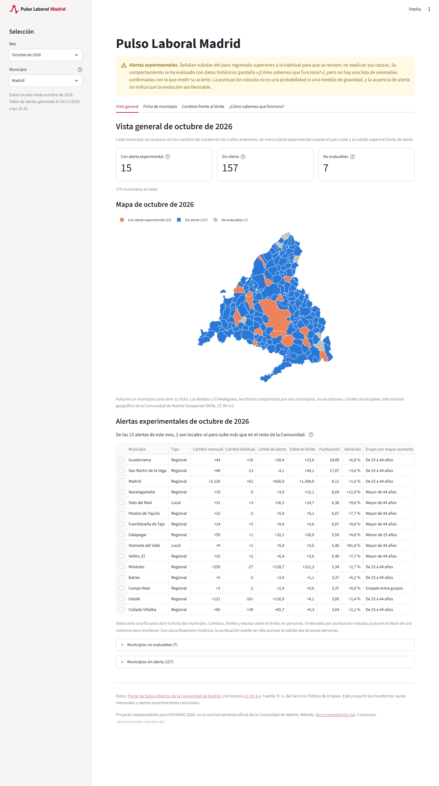
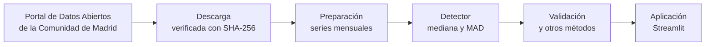
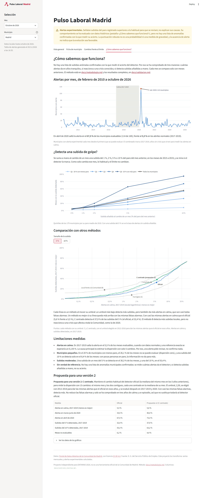

<p align="center">
  
</p>

<h1 align="center">Pulso Laboral Madrid</h1>

<p align="center">
  <strong>Detección temprana de aumentos inusuales del paro registrado en los 179 municipios de la Comunidad de Madrid</strong>
</p>

<p align="center">
  <a href="https://github.com/romanmen-dev/pulso-laboral-madrid/actions/workflows/pruebas.yml"></a>
  <a href="LICENSE"></a>
  
</p>

<p align="center">
  <a href="https://pulso-laboral-madrid.streamlit.app/"></a>
</p>

Cada mes cambia el paro registrado de los 179 municipios de la Comunidad de Madrid. Pulso Laboral Madrid compara cada cambio con lo habitual en ese municipio y en esa época del año, y señala las subidas que se salen de lo esperable para que se revisen a tiempo. Usa solo datos abiertos y se puede probar en la [aplicación publicada](https://pulso-laboral-madrid.streamlit.app/).

> Las alertas son **experimentales**. Su comportamiento se ha evaluado con datos históricos ([validación](docs/validacion.md)), pero no hay una lista de anomalías confirmadas con la que medir su acierto.

[Para quién](#para-quién) · [Caso de uso](#caso-de-uso-ilustrativo) · [Cómo funciona](#cómo-funciona) · [Resultados](#resultados) · [Datos](#datos) · [Limitaciones](#limitaciones) · [Instalación](#instalación-y-reproducción) · [Equipo](#equipo)



<p align="center"><em>Vista general de octubre de 2026 en la aplicación: recuento, mapa de municipios y tabla de alertas.</em></p>

## Para quién

Está pensada para estos usuarios potenciales. Todavía no se ha probado con ellos.

- **Técnicos de empleo:** ver qué municipios tienen este mes una subida del paro inusual y qué grupo de edad la concentra.
- **Servicios regionales de empleo:** una vista conjunta de los 179 municipios para decidir qué casos revisar primero.
- **Agentes de desarrollo local:** seguir mes a mes el paro y los contratos de su municipio frente a su propio historial.
- **Investigadores:** una serie mensual armonizada de 2005 a 2026 y un detector documentado y reproducible.

## Caso de uso (ilustrativo)

> Ejemplo ilustrativo con los datos reales de octubre de 2026. Muestra cómo se usaría la herramienta; no describe un uso real.

1. **Detectar.** En la vista general de octubre de 2026, Madrid aparece entre los 15 municipios con alerta experimental. La columna «Tipo» indica que su alerta es regional; solo 2 de las 15 son locales.
2. **Abrir la ficha.** Al seleccionar su fila se abre la ficha: el paro subió 2.130 personas, cuando lo habitual en octubre era +61 y el límite de alerta, +826. Es una alerta regional: el paro sube en línea con el conjunto de la Comunidad. El grupo con mayor aumento es el de 25 a 44 años (+1.074).
3. **Contrastar.** La pestaña «Cambios frente al límite» muestra si la subida es aislada o se repite en otros meses. El técnico lo cruza con la información local que conozca. Al final de la ficha, en una sección aparte y plegada, «Contratos registrados en centros de trabajo del municipio», están los contratos del municipio. No se comparan con el paro: se cuentan por centro de trabajo y son contratos, no personas.
4. **Decidir si investigar.** La alerta no explica la causa: indica que la subida merece una revisión. Investigar o no es una decisión del técnico.

## Cómo funciona



Cada paso es un script de `src/` (ver [Instalación y reproducción](#instalación-y-reproducción)). La regla del detector, para cada municipio y mes:

1. **Cambio mensual:** paro del mes menos paro del mes anterior.
2. **Cambio habitual:** mediana de los cambios del mismo mes en los cinco años anteriores. El mes evaluado no entra en su propia referencia.
3. **Límite de alerta:** cambio habitual + 3 × 1,4826 × MAD de esos cinco cambios.
4. **Alerta experimental:** el paro sube y el cambio supera el límite. Con menos de cinco cambios o con MAD igual a cero, el mes no es evaluable.

**Ejemplo: Madrid, octubre de 2026.** El paro subió **+2.130** personas. Lo habitual en octubre (mediana de 2021 a 2025) era +61 y el límite, **+826**, así que se marca como alerta experimental: la subida supera el límite en 1.304 personas.

El método completo, con fórmulas, validación, comparación con otros métodos y limitaciones, está en [`docs/metodologia.md`](docs/metodologia.md), en una página. El formato de los resultados está en [`docs/contrato_alertas.md`](docs/contrato_alertas.md), y el desarrollo inicial, en [`notebooks/02_detector_inicial.ipynb`](notebooks/02_detector_inicial.ipynb).

Cada alerta lleva además una etiqueta de contraste, **local** o **regional**, que no cambia su estado. Es local si el paro sube más que en el resto de la Comunidad y regional si sube en línea con ella. La calcula un segundo método (B) a partir de la relación del municipio con el resto de la Comunidad en los 60 meses anteriores.

## Resultados

Cifras calculadas sobre la tabla de alertas que usa la aplicación ([`datos/publicados/alertas.csv`](datos/publicados/alertas.csv)).

**Octubre de 2026, último mes disponible:**

| Estado | Municipios |
|---|---:|
| Con alerta experimental | 15 |
| Sin alerta | 157 |
| No evaluables (dispersión cero) | 7 |
| **Total** | **179** |

**Serie completa, de enero de 2005 a octubre de 2026 (46.898 combinaciones de municipio y mes):**

- 1.859 alertas experimentales, el 5,5 % de los 33.739 meses evaluables. Es la frecuencia de alertas, no una medida de acierto.
- 31.880 meses sin alerta.
- 13.159 meses no evaluables: 10.919 por historial insuficiente (los primeros 61 meses de cada municipio, de enero de 2005 a enero de 2010) y 2.240 por dispersión cero.

### Validación

No hay una lista de anomalías municipales confirmadas, así que se mide el comportamiento del detector, sin información futura, de febrero de 2010 a octubre de 2026. Resultados completos en [`docs/validacion.md`](docs/validacion.md) y resumen en [`docs/metodologia.md`](docs/metodologia.md).

- **Responde a una crisis conocida.** En abril de 2020 saltó la alerta en el 67,5 % de los municipios evaluables (114 de 169), frente al 5,5 % en los abriles de 2017-2019.
- **Da más alertas en calma de lo nominal.** En 2017-2019, años sin crisis, marca el 5,51 % de los meses, frente al 0,135 % teórico. La causa es estimar la dispersión con solo 5 cambios.
- **Detecta las subidas grandes en los municipios grandes.** Sumando a mano una subida al cambio de un mes, detecta el 30,3 % de las del 5 % y el 55,4 % de las del 10 %. Con la del 10 %, el 94,8 % en el 20 % de municipios con más paro y el 8,4 % en el 20 % con menos.
- **No se recomienda todavía otro método.** Se ha comparado con tres alternativas. Con el umbral elegido fuera de muestra, ninguna mejora a la vez las alertas en calma, la respuesta a 2020 y la potencia. La propuesta para una versión 2, «C centrado», da casi las mismas alertas en calma (5,62 % frente a 5,51 %) y detecta más (37,9 % frente a 32,4 % de las subidas del 5 %).

La aplicación lo muestra en la pestaña **«¿Cómo sabemos que funciona?»**: alertas por mes, el episodio de 2020, la potencia por tamaño de municipio, la comparación de métodos y las limitaciones medidas.



## Datos

| Conjunto de datos | Uso |
|---|---|
| [Paro registrado, por edad y municipio](https://datos.comunidad.madrid/dataset/paro_registrado_edad_municipio) | Serie principal: detector y desglose por edad |
| [Contratos de trabajo, por municipio](https://datos.comunidad.madrid/dataset/contratos_trabajo_municipio) | Contexto, en una sección aparte de la ficha: «Contratos registrados en centros de trabajo del municipio». No se compara con el paro porque se cuenta por centro de trabajo y son contratos, no personas. No interviene en el detector |
| [Municipios de la Comunidad de Madrid](https://datos.comunidad.madrid/dataset/municipio_comunidad_madrid) | Correspondencia entre nombre y código INE, para cruzar el mapa por código |
| [Límites municipales del Geoportal IDEM](https://idem.comunidad.madrid/catalogocartografia/srv/spa/catalog.search#/metadata/spacm_divisionesadmin) | Mapa de la vista general |

- **Cobertura:** 179 municipios, de enero de 2005 a octubre de 2026 (262 meses). Paro y contratos descargados el 18/11/2026; municipios y límites, el 20/11/2026. Todos se verifican con su huella SHA-256.
- **Licencia:** [CC BY 4.0](https://creativecommons.org/licenses/by/4.0/legalcode.es). Datos del Portal de Datos Abiertos de la Comunidad de Madrid, publicados por su Instituto de Estadística. Fuente: D. G. del Servicio Público de Empleo. Este proyecto los transforma: series mensuales, nombres de municipio armonizados y alertas calculadas.
- **Límites municipales:** Infraestructura de Datos Espaciales de la Comunidad de Madrid (Geoportal IDEM), con licencia CC BY 4.0 Comunidad de Madrid. Atribución: «Información geográfica de la Comunidad de Madrid. Acceso público y gratuito en CC BY 4.0 Comunidad de Madrid». Para el mapa, se unen los enclaves a su municipio, se dejan sin colorear los dos territorios compartidos (Los Baldíos y El Redegüelo) y se simplifica la geometría.
- **Paro y contratos no miden lo mismo:** los contratos se agrupan por la localidad del centro de trabajo, vivan donde vivan las personas contratadas, y se cuentan contratos, no personas. Por eso la aplicación los muestra aparte, sin compararlos con el paro.
- **Incidencias documentadas en los contratos**, presentes en el archivo original y sin corregir. La aplicación avisa de ellas en la sección de contratos de la ficha:
  - Mayo de 2026: 96.263 contratos, frente a 176.830 en abril y 233.453 en junio. Bajan 167 de los 178 municipios comparables.
  - Velilla de San Antonio: 368 contratos todos los meses desde septiembre de 2025.

Más detalle en [`docs/fuentes_datos.md`](docs/fuentes_datos.md).

## Limitaciones

> **Una alerta estadística no demuestra por sí sola un deterioro del mercado laboral ni identifica sus causas: señala una variación que merece ser investigada.**

- Las alertas son experimentales. Tras la validación se mantiene el umbral de 3, que en calma marca un 5,5 % de los meses: una alerta pide revisar el caso, no confirma nada.
- La etiqueta local/regional también es experimental: depende de un segundo método (B) y no cambia el estado oficial de la alerta.
- La referencia usa solo cinco cambios, así que su estimación es inestable. Con poca dispersión histórica, la puntuación puede ser alta aunque la subida sea de pocas personas. La puntuación no es una probabilidad ni una medida de gravedad.
- Los meses con dispersión cero no se pueden evaluar. Se concentran en municipios con poco paro registrado.
- El método compara el mismo mes de años anteriores, pero no modeliza la tendencia reciente.
- El grupo con mayor aumento no indica una anomalía propia de ese grupo.
- El paro total es la suma de los tres grupos de edad y está pendiente de contraste con los totales oficiales.

Las decisiones metodológicas y sus motivos están en [`docs/decisiones.md`](docs/decisiones.md).

## Instalación y reproducción

### Requisitos

Estas instrucciones están preparadas para Windows y PowerShell.

- Git.
- Python 3.12 o posterior. La aplicación publicada usa Python 3.12; el proyecto también se ha ejecutado con Python 3.14.
- Visual Studio Code.
- Extensiones Python y Jupyter de Microsoft.
- Acceso al repositorio de GitHub. Para subir cambios, hay que aceptar la invitación como colaborador.

Comprobar las instalaciones:

```powershell
git --version
python --version
```

### Instalación inicial

Cada integrante realiza estos pasos una vez en su ordenador.

#### 1. Clonar el repositorio

En GitHub, abrir este repositorio y copiar su dirección desde Code → HTTPS.

En PowerShell, entrar en la carpeta donde se quiera guardar el proyecto.

Escribir `git clone`, seguido de un espacio y de la dirección copiada. Pulsar Intro y esperar a que finalice la descarga.

Después:

```powershell
cd pulso-laboral-madrid
```

Abrir esta carpeta en VS Code mediante Archivo → Abrir carpeta.

Los siguientes comandos se ejecutan desde la carpeta principal del proyecto, donde se encuentra `app.py`.

#### 2. Crear el entorno

```powershell
python -m venv .venv
```

Cada integrante crea su propio entorno `.venv` en su ordenador.

#### 3. Instalar las dependencias

```powershell
.\.venv\Scripts\python.exe -m pip install -r requirements-dev.txt
```

`requirements-dev.txt` incluye `requirements.txt`, así que este comando instala los dos:

- `requirements.txt`: lo mínimo para la aplicación. Es lo que instala Streamlit Community Cloud.
- `requirements-dev.txt`: añade la cadena de datos, Jupyter y las herramientas de desarrollo.

#### 4. Seleccionar el intérprete en VS Code

1. Pulsar Ctrl + Shift + P.
2. Buscar Python: Select Interpreter.
3. Seleccionar el intérprete situado en `.venv\Scripts\python.exe`.

En los cuadernos Jupyter, seleccionar también este entorno mediante Select Kernel.

#### 5. Ejecutar la aplicación

```powershell
.\.venv\Scripts\python.exe -m streamlit run app.py
```

Abrir en el navegador la dirección que figure como Local URL en la terminal, normalmente http://localhost:8501.

La aplicación usa las tablas locales si están todas y, si no, la copia de `datos/publicados/` incluida en el repositorio, así que funciona nada más clonar. La barra lateral indica de dónde salen los datos y hasta qué mes llegan. Si no encuentra ninguna de las dos, indica los comandos que hay que ejecutar (ver «Datos y reproducibilidad»).

Si se modifica un archivo de `src/` con la aplicación abierta y no se ven los cambios, detenerla y volver a ejecutarla.

Mantener la terminal abierta mientras se utiliza la aplicación. Para detenerla, pulsar Ctrl + C en esa terminal.

Cada ordenador ejecuta su propia copia de la aplicación.

#### 6. Ejecutar las pruebas

```powershell
.\.venv\Scripts\python.exe -m pytest
```

Comprueban el contrato de `datos/publicados/alertas.csv`, el detector, la validación y los métodos alternativos con series sintéticas, el mapa, las huellas de la copia publicada y la propia aplicación, sin necesitar los datos originales; GitHub Actions las ejecuta en cada push y pull request.

### Datos y reproducibilidad

Los CSV originales y procesados no se incluyen en GitHub: `.gitignore` excluye el contenido de `datos/originales/` y `datos/procesados/`, salvo sus `.gitkeep`. Clonar o actualizar el repositorio descarga el código, y los datos se obtienen con los pasos siguientes, desde la carpeta principal del proyecto.

La única excepción es `datos/publicados/`: una copia versionada de las tablas que lee la aplicación, para poder publicarla (paso 6). La aplicación usa las tablas locales si están todas y, si no, esa copia.

Las páginas de origen están documentadas en `docs/fuentes_datos.md`.

#### Forma rápida: toda la cadena

```powershell
.\.venv\Scripts\python.exe .\src\ejecutar_todo.py
```

Ejecuta en orden los pasos 1 a 6: descarga, comprobación, preparación de las tablas y del mapa, detección, validación y comparación de métodos, y publicación. Se detiene en el primer paso que falle e indica cuál ha sido. Después, conviene ejecutar las pruebas (paso 7). Los apartados siguientes explican cada paso por separado.

#### 1. Descargar los datos originales

```powershell
.\.venv\Scripts\python.exe .\src\descargar_datos.py
```

El script descarga los cuatro archivos del proyecto y los guarda en `datos/originales/`:

- `paro_edad_municipio.csv` y `contratos_municipio.csv`: paro y contratos, del Portal de Datos Abiertos de la Comunidad de Madrid.
- `municipios_comunidad_madrid.csv`: nombres y códigos INE de los municipios, del mismo portal.
- `limites_municipales_idem.csv`: límites municipales, del servicio WFS del Geoportal IDEM.

Para garantizar que todos trabajan con los mismos datos, compara la huella SHA-256 de cada descarga con la de la versión revisada:

- Si coincide y el archivo no existía, lo guarda.
- Si el archivo ya existía, comprueba que es idéntico y lo conserva.
- Nunca sobrescribe un original.

Cada ejecución deja un registro en `resultados/descargas/` con la dirección, la hora, el tamaño y la huella de cada archivo.

Si el portal publica una versión nueva, la huella no coincidirá y el script se detendrá sin modificar nada. Es intencionado: para usar datos nuevos hay que revisarlos y actualizar las huellas en `src/descargar_datos.py`.

#### 2. Comprobar y preparar los datos

```powershell
.\.venv\Scripts\python.exe .\src\comprobar_datos.py
.\.venv\Scripts\python.exe .\src\preparar_datos.py
```

El primer script genera informes en `resultados/`.
El segundo genera estas tablas en `datos/procesados/`:

| Archivo | Contenido |
|---|---|
| paro_edad_mensual.csv | Paro mensual por municipio y grupo de edad |
| paro_total_mensual.csv | Suma mensual de los tres grupos de edad por municipio |
| contratos_mensuales.csv | Recuento mensual de contratos por municipio |

Los CSV generados utilizan separador `;` y codificación `utf-8-sig`.
La columna `fecha` identifica el mes mediante su primer día.

La versión revisada, descargada el 18/11/2026, contiene 179 municipios
y 262 meses, desde enero de 2005 hasta octubre de 2026.

Se excluyen las medias anuales y las tasas publicadas.
Los archivos originales se conservan sin modificar.

`preparar_datos.py` armoniza los nombres de contratos con los de paro
(6 equivalencias) y comprueba que ambos conjuntos de municipios coinciden,
así que las dos tablas se pueden cruzar por `municipio`.

El paro total calculado aún está pendiente de contraste con
una fuente independiente de totales oficiales.

#### 3. Preparar el mapa

```powershell
.\.venv\Scripts\python.exe .\src\preparar_mapa.py
```

Genera `datos/procesados/municipios_mapa.geojson`, la geometría del mapa de la vista general. Cruza los límites con los municipios del paro por código INE, no por nombre; une los 13 enclaves a su municipio, deja fuera las 2 comunidades jurisdiccionales (territorios compartidos por dos municipios) y simplifica la geometría sin dejar huecos entre vecinos. Se detiene si algún municipio no tiene exactamente un término municipal. Necesita las tablas del paso 2 y `shapely`, incluido en `requirements-dev.txt`.

#### 4. Detectar alertas

```powershell
.\.venv\Scripts\python.exe .\src\detectar_alertas.py
```

El script aplica el detector experimental de `notebooks/02_detector_inicial.ipynb`
y genera `resultados/alertas.csv`, con una fila por municipio y mes.
Su formato se describe en `docs/contrato_alertas.md`. Antes de escribirlo,
comprueba las reglas del contrato y se detiene si alguna falla.
El archivo no se incluye en GitHub.

#### 5. Validar el detector y compararlo con otros métodos

```powershell
.\.venv\Scripts\python.exe .\src\validar_detector.py
.\.venv\Scripts\python.exe .\src\comparar_metodos.py
```

El primero mide el comportamiento del detector oficial sin modificarlo: alertas por mes, falsas alarmas en calma, episodio de 2020, potencia con subidas sintéticas, sensibilidad, municipios pequeños y persistencia. El segundo lo compara con tres métodos alternativos y clasifica cada alerta como local o regional. Escriben CSV y figuras en `resultados/validacion/`. Tardan alrededor de un minuto cada uno y necesitan `matplotlib` y, para una prueba, `statsmodels`, incluidos en `requirements-dev.txt`. Los resultados se explican en `docs/validacion.md` y, en una página, en `docs/metodologia.md`.

#### 6. Publicar los datos de la aplicación

```powershell
.\.venv\Scripts\python.exe .\src\publicar_datos.py
```

Copia a `datos/publicados/` lo que lee la aplicación: `resultados/alertas.csv`, `paro_edad_mensual.csv`, `contratos_mensuales.csv`, `municipios_mapa.geojson` y, de `resultados/validacion/`, los resultados de la validación (`validacion_mensual.csv`, `potencia.csv`, `resumen_metodos.csv`, `curvas_metodos.csv`, `clasificacion_local_regional.csv` y `otros_metodos.csv`).

Escribe también `publicacion.json`, con la fecha de generación, el periodo de los datos, el commit, la atribución de la licencia y las huellas SHA-256 de los originales y de cada archivo. Se detiene si `alertas.csv` es anterior a los datos procesados, si los resultados de la validación son anteriores a `alertas.csv` o si los originales no son la versión revisada.

Después hay que hacer commit de `datos/publicados/` para que la aplicación publicada use los datos nuevos. `.gitattributes` hace que Git guarde esa carpeta byte a byte, sin cambiar los finales de línea, para que las huellas sigan siendo válidas.

#### 7. Comprobar con las pruebas

```powershell
.\.venv\Scripts\python.exe -m pytest
```

Comprueban la copia de `datos/publicados/`:

- que `alertas.csv` cumple las reglas de `docs/contrato_alertas.md`;
- que el mapa tiene exactamente una geometría por municipio;
- que las huellas de `publicacion.json` coinciden con los archivos;
- que la clasificación local/regional cubre todas las alertas oficiales.

También prueban con series sintéticas el detector, la validación y los métodos alternativos: un caso conocido (Madrid, octubre de 2026) y que ningún resultado usa información de meses posteriores. Por último, abren la aplicación con `AppTest` de Streamlit, solo con `datos/publicados/`: la vista general, la pestaña «¿Cómo sabemos que funciona?» y las fichas de varios municipios.

Conviene ejecutarlas antes de hacer commit de `datos/publicados/`. No necesitan los datos originales. GitHub Actions las ejecuta en cada push y pull request, con Python 3.12 y 3.13.

#### Revisión de las incidencias de los contratos

Para reproducir la revisión de las incidencias de los contratos (mayo de 2026, Velilla de San Antonio y redondeo a múltiplos de 5), ejecutar `.\.venv\Scripts\python.exe .\src\investigar_contratos.py`: no modifica datos y escribe sus resultados en `resultados/investigacion_contratos/` (ver `docs/decisiones.md`).

### Organización del proyecto

| Ruta | Contenido |
|---|---|
| `app.py` | Entrada de la aplicación Streamlit |
| `.streamlit/config.toml` | Tema de la aplicación (modo claro y oscuro) |
| `assets/` | Logo e icono propios del proyecto, en SVG |
| `requirements.txt` | Dependencias mínimas de la aplicación |
| `requirements-dev.txt` | Dependencias de desarrollo (incluye `requirements.txt`) |
| `datos/originales/` | Ficheros descargados de las fuentes |
| `datos/procesados/` | Tablas generadas por la preparación |
| `datos/publicados/` | Copia versionada de los datos que lee la aplicación publicada |
| `notebooks/` | Exploración y análisis |
| `src/` | Código reutilizable y scripts de la cadena de datos (`ejecutar_todo.py` la ejecuta entera) |
| `tests/` | Pruebas automáticas con pytest: contrato de alertas, detector, validación, métodos alternativos, mapa, copia publicada y aplicación |
| `.github/` | Flujo de GitHub Actions que ejecuta las pruebas en cada push y pull request |
| `resultados/` | Informes de comprobación, registros de descarga, tablas y gráficos; `resultados/validacion/`, los de la validación |
| `docs/` | Metodología en una página, validación, contrato de alertas, fuentes y decisiones |

Los archivos `.gitkeep` permiten conservar las carpetas vacías en Git.

### Cómo trabajar sincronizados

GitHub contiene el trabajo compartido. Cada integrante trabaja en una copia local.

Guardar un archivo en VS Code modifica la copia local. Para compartirlo hay que crear un commit y subirlo con push. El otro integrante recibe los cambios mediante pull.

#### Antes de empezar una tarea

Comprobar si hay cambios locales pendientes:

```powershell
git status
```

Si existen cambios, guardarlos en la rama correspondiente antes de cambiar de rama.

Con el trabajo anterior guardado, actualizar la rama principal:

```powershell
git switch main
git pull --ff-only
```

Crear una rama nueva para la tarea. Por ejemplo, Rodrigo puede usar:

```powershell
git switch -c rodrigo/descarga-datos
```

Roman puede usar:

```powershell
git switch -c roman/exploracion-inicial
```

Estos comandos crean ramas nuevas. Para volver a una rama existente se utiliza `git switch` seguido de su nombre.

#### Guardar y subir una tarea

Guardar los archivos en VS Code y revisar los cambios:

```powershell
git status
git diff
```

Después:

```powershell
git add .
git commit -m "Describe brevemente el cambio realizado"
git push -u origin HEAD
```

Sustituir el mensaje del commit por una descripción concreta.

#### Incorporar cambios al proyecto compartido

1. Abrir el repositorio en GitHub.
2. Crear una pull request desde la rama de la tarea hacia `main`.
3. Explicar qué se ha cambiado y cómo se ha comprobado.
4. Pedir al otro integrante que revise los archivos.
5. Fusionar la pull request cuando esté revisada.

Después de la fusión, ambos actualizan su copia de `main`, con sus cambios locales previamente guardados:

```powershell
git switch main
git pull --ff-only
```

#### Actualizar una tarea que sigue en curso

Con los cambios de la tarea guardados en un commit, ejecutar desde su rama:

```powershell
git fetch origin
git merge origin/main
```

Esto incorpora el trabajo que ya se haya fusionado en la rama principal.

Si aparecen conflictos, revisar conjuntamente los archivos afectados antes de continuar.

### Dependencias

Cuando cambie `requirements.txt` o `requirements-dev.txt`, actualizar el entorno local:

```powershell
.\.venv\Scripts\python.exe -m pip install -r requirements-dev.txt
```

Si alguien añade una biblioteca, debe instalarla dentro de `.venv` y añadirla a mano, con su versión exacta (`paquete==versión`), en el archivo que corresponda:

- `requirements.txt`, si la usa la aplicación (`app.py` o `src/*_app.py`).
- `requirements-dev.txt`, si solo la usan los scripts de datos o los cuadernos.

No sobrescribir `requirements.txt` con `pip freeze`: incluiría paquetes de Windows y de Jupyter que no se pueden o no se deben instalar en Streamlit Community Cloud.

Incluir ese cambio en la pull request y avisar al otro integrante.

### Acuerdos de trabajo

- Comunicar qué tarea y archivos está modificando cada integrante.
- Acordar los nombres de columnas y formatos antes de integrar análisis y aplicación.
- Utilizar rutas relativas al proyecto.
- Guardar las decisiones metodológicas en `docs/`.
- Mantener actualizado este README cuando cambie la instalación o la ejecución.

## Equipo

Proyecto para DATAMAD 2026.

- **Roman** (Estadística Aplicada): método y validación.
- **Rodrigo** (Ingeniería de Datos e Inteligencia Artificial): datos, ingeniería y aplicación.

## Licencia

- **Código:** licencia MIT. Ver [`LICENSE`](LICENSE).
- **Datos:** CC BY 4.0 del Portal de Datos Abiertos de la Comunidad de Madrid. Ver [Datos](#datos).

Pulso Laboral Madrid es un proyecto independiente: no es una herramienta oficial de la Comunidad de Madrid. El logo es propio.
