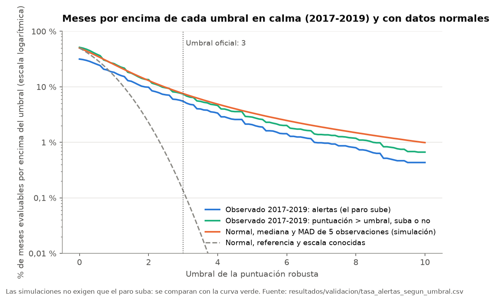
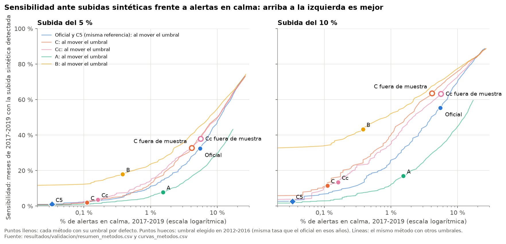

# Validación del detector

Evaluación del detector oficial (`src/detectar_alertas.py`: ventana de 5 años,
mínimo de 5 cambios, umbral 3) sin modificarlo. Los resultados los genera
`src/validar_detector.py` en `resultados/validacion/`, y cada cifra de este
documento indica el CSV del que sale.

```powershell
.\.venv\Scripts\python.exe .\src\validar_detector.py
.\.venv\Scripts\python.exe .\src\comparar_metodos.py
```

El segundo script compara el detector con tres métodos alternativos; sus
resultados están en la sección
[Comparación con métodos alternativos](#comparación-con-métodos-alternativos).

## Cómo se ha hecho

- El script lee `resultados/alertas.csv` (o `datos/publicados/alertas.csv`) y
  `datos/procesados/paro_total_mensual.csv`, y recalcula el detector con sus
  propias funciones. Antes de seguir comprueba que, con los parámetros
  oficiales, reproduce `alertas.csv` en estado, alerta, referencia, escala,
  límite y puntuación.
- Las variantes (ventana de 3, 5 y 7 años; umbral de 2,5, 3 y 3,5) cambian los
  parámetros del módulo solo en memoria. Como en el oficial, la ventana exige
  historial completo: 3, 5 o 7 cambios.
- Sin información futura: cada mes se compara solo con el mismo mes de años
  anteriores. Los quintiles de tamaño (paro medio de 2019) y los umbrales
  calibrados en 2017-2019 solo describen resultados: no intervienen en ninguna
  detección.
- Subidas sintéticas: se suma la subida al cambio real del mes evaluado, que
  puede ser negativo, y se aplica la regla del detector (sube y puntuación >
  umbral) con su referencia y su escala, que solo dependen de años anteriores. El script lo comprueba
  ejecutando el detector completo sobre la serie con la subida de 2019 (5 %), y
  `tests/test_validacion.py` lo comprueba con varios años y tamaños: una subida
  nula da las alertas oficiales y una enorme se detecta en todos los meses
  evaluables.

## 1. Comportamiento histórico

Febrero de 2010 (primer mes evaluable) a octubre de 2026: 201 meses
([`validacion_mensual.csv`](../resultados/validacion/validacion_mensual.csv)).

- 33.739 municipio-mes evaluables, con 1.859 alertas: el **5,51 %**. Además,
  2.240 municipio-mes no evaluables por dispersión cero y ninguno por historial
  insuficiente. Cada mes hay entre 160 y 177 municipios evaluables de 179.
- La mediana mensual del % de alertas es 4,35 %. En 8 meses no hay ninguna
  alerta.
- Los meses con más alertas son abril de 2020 (114), mayo de 2020 (58) y marzo
  de 2020 (42). Les siguen enero de 2012 y diciembre de 2020 (31 cada uno).
- Por años ([`validacion_anual.csv`](../resultados/validacion/validacion_anual.csv)),
  2020 tiene un 16,3 % de alertas. El resto de los años, entre el 2,7 % (2016)
  y el 7,7 % (2019).


## 2. Alertas en un periodo de referencia estable (2017-2019)

Se toma 2017-2019 como periodo de referencia estable, sin crisis. No hay
anomalías municipales verificadas, así que no se puede saber cuántas de sus
alertas son falsas. Por eso este documento no habla de «falsas alarmas», sino de
**tasa de alertas en calma**: cuántas alertas da el detector en años sin crisis
conocida. Tampoco está garantizado que esos años no tengan subidas reales: 2019
ya tiene un 7,7 % de alertas
([`validacion_anual.csv`](../resultados/validacion/validacion_anual.csv)).

| Medida | Valor |
|---|---:|
| Municipio-mes evaluables | 6.006 |
| Alertas | 331 |
| **% de alertas** | **5,51 %** |
| Referencia de una normal con media y escala conocidas, P(Z > 3) | 0,135 % |
| Simulado con normalidad, mediana y MAD de 5 cambios | 7,58 % |
| Observado sin exigir que el paro suba (puntuación > 3) | 7,43 % |
| Puntuación < −3 (cola inferior) | 5,13 % |
| Puntuación mediana de los evaluables | 0,10 |

Fuente: [`calma_2017_2019.csv`](../resultados/validacion/calma_2017_2019.csv).
La simulación usa 1.000.000 de repeticiones con semilla 2026.

**El 0,135 % no es la tasa que debería dar el detector.** Es la de una normal
con media y escala conocidas. El detector estima las dos con solo 5 cambios, y
eso hace que la puntuación supere 3 mucho más a menudo, aunque los datos sean
normales. Las colas pesadas no están en los datos, sino en la puntuación:

- Con 5 valores, uno de los desvíos respecto a la mediana es siempre 0, y la
  MAD es el segundo menor de los otros cuatro. Suele quedar pequeña y varía
  mucho de un caso a otro, así que la puntuación se dispara. Aunque los cambios
  fueran normales, un 7,58 % de los meses superaría 3.
- En calma, el 7,43 % de los meses evaluables supera 3 si no se exige que el
  paro suba: casi lo mismo que la simulación. Con umbrales más altos, lo
  observado queda por debajo de la simulación. Con 6: 2,01 % frente a 2,47 %.
  Con 10: 0,67 % frente a 0,99 %
  ([`tasa_alertas_segun_umbral.csv`](../resultados/validacion/tasa_alertas_segun_umbral.csv)).
  Una vez descontado el efecto de la MAD de 5, los datos no muestran colas más
  pesadas que la normal.
- Exigir que el paro suba lo reduce del 7,43 % al 5,51 %.
- Los recuentos pequeños pesan: el 14,9 % de los meses evaluables tiene una MAD
  de 1 persona o menos. En ellos hay un 9,85 % de alertas, frente al 4,75 % del
  resto ([`calma_2017_2019.csv`](../resultados/validacion/calma_2017_2019.csv)).



**Umbral que daría cada tasa en 2017-2019.** Solo informa: el umbral oficial
no cambia. Se calibra dentro de la misma muestra
([`umbrales_calma.csv`](../resultados/validacion/umbrales_calma.csv)).

| Objetivo | Umbral | Alertas | % obtenido |
|---:|---:|---:|---:|
| 1 % | 6,74 | 60 | 1,00 % |
| 2 % | 5,06 | 119 | 1,98 % |
| 5 % | 3,15 | 293 | 4,88 % |
| Oficial | 3 | 331 | 5,51 % |

## 3. Episodio de 2020

Comparación de marzo a junio de 2020 con los mismos meses de 2017-2019
([`episodio_2020.csv`](../resultados/validacion/episodio_2020.csv)).
Para 2017-2019 se da la media anual de alertas y los porcentajes de los tres
años agregados. El % del paro es el paro de los municipios en alerta sobre el
de los 179 municipios ese mes.

| Mes | Alertas 2017-2019 (media) | % evaluables 2017-2019 | % paro 2017-2019 | Alertas 2020 | % evaluables 2020 | % paro 2020 |
|---|---:|---:|---:|---:|---:|---:|
| Marzo | 9,7 | 5,9 % | 3,0 % | 42 de 163 | 25,8 % | 78,1 % |
| **Abril** | 9,3 | 5,5 % | 0,8 % | **114 de 169** | **67,5 %** | **98,7 %** |
| Mayo | 9,3 | 5,5 % | 1,1 % | 58 de 169 | 34,3 % | 86,9 % |
| Junio | 9,0 | 5,4 % | 1,1 % | 10 de 168 | 6,0 % | 1,4 % |

**La señal se concentra en abril de 2020.** Ese mes, el paro de la Comunidad
(suma de los 179 municipios) subió en 41.263 personas, frente a una media de
−9.283 en abril de 2017-2019. En junio, el detector vuelve a niveles de calma.

## 4. Sensibilidad ante subidas sintéticas

Meses evaluables de 2015 a 2019: 10.068 municipio-mes. Al cambio real de cada
uno se le suma una subida del 1 %, 2 %, 5 % o 10 % del paro del mes anterior,
redondeada a personas (las mitades, hacia arriba). El cambio real puede ser
negativo: si el paro bajaba 20 personas y se suman 15, el resultado sigue
siendo una bajada y no puede dar alerta. Son saltos puntuales de un solo mes, no
crisis graduales ni prolongadas. La tasa de detección incluye los meses que ya
tenían alerta sin la subida: es la fila del 0 %
([`potencia.csv`](../resultados/validacion/potencia.csv)). En el resto del
documento, «sensibilidad» es esta tasa de detección (en los CSV, columnas
`potencia_*`).

Quintiles de los 179 municipios por su paro medio de 2019 (Q1, los más
pequeños: de 1,8 a 39,3 personas; Q5: de 811,8 a 163.525,8). Detalle por
municipio en
[`quintiles_tamano.csv`](../resultados/validacion/quintiles_tamano.csv).

| Subida | Todos | Q1 | Q2 | Q3 | Q4 | Q5 |
|---:|---:|---:|---:|---:|---:|---:|
| 0 % | 4,6 % | 2,5 % | 5,8 % | 5,9 % | 5,0 % | 3,5 % |
| 1 % | 7,5 % | 2,5 % | 7,2 % | 8,2 % | 9,0 % | 9,3 % |
| 2 % | 11,9 % | 3,0 % | 9,2 % | 11,3 % | 13,5 % | 20,0 % |
| 5 % | **30,3 %** | 4,6 % | 16,8 % | 23,6 % | 33,8 % | 65,4 % |
| 10 % | **55,4 %** | 8,4 % | 33,2 % | 53,6 % | 73,9 % | 94,8 % |

- Solo entre los meses sin alerta previa (9.602), se detecta el 3,0 %, 7,6 %,
  27,0 % y 53,2 % de las subidas del 1 %, 2 %, 5 % y 10 %. Con la del 10 %, el
  94,6 % en Q5 y el 6,0 % en Q1 (columna
  `tasa_deteccion_sin_alerta_previa_pct`).
- En Q1 la subida mediana es de 0 personas con el 1 % y el 2 %, y de 1 persona
  con el 5 % y el 10 %. Con el 1 %, la subida es nula en 1.517 de sus 1.586
  meses.


## 5. Efecto de la ventana y del umbral

Fuente: [`sensibilidad.csv`](../resultados/validacion/sensibilidad.csv).
«Cobertura» es el % de municipio-mes evaluables en 2017-2019. «2020» es el %
de alertas entre evaluables de marzo a junio de 2020. «Subida del 5 %» es la
sensibilidad ante la subida sintética del 5 % en 2015-2019. Jaccard compara los
conjuntos de alertas con los del oficial desde febrero de 2012, primer mes en
que todas las variantes tienen historial (1.594 alertas oficiales).

| Ventana | Umbral | Cobertura | % alertas en calma | 2020 | Subida del 5 % (2015-2019) | Jaccard |
|---:|---:|---:|---:|---:|---:|---:|
| 3 | 2,5 | 84,3 % | 11,4 % | 44,0 % | 46,7 % | 0,33 |
| 3 | 3 | 84,3 % | 9,5 % | 38,2 % | 41,8 % | 0,35 |
| 3 | 3,5 | 84,3 % | 7,7 % | 35,7 % | 37,5 % | 0,33 |
| 5 | 2,5 | 93,2 % | 7,2 % | 38,0 % | 36,4 % | 0,77 |
| **5** | **3** | **93,2 %** | **5,5 %** | **33,5 %** | **30,3 %** | **1** |
| 5 | 3,5 | 93,2 % | 4,0 % | 30,6 % | 25,3 % | 0,76 |
| 7 | 2,5 | 96,1 % | 4,0 % | 38,5 % | 27,3 % | 0,43 |
| 7 | 3 | 96,1 % | 2,5 % | 31,9 % | 21,1 % | 0,44 |
| 7 | 3,5 | 96,1 % | 1,5 % | 25,6 % | 16,5 % | 0,34 |

- Todas las variantes responden a 2020: entre el 25,6 % y el 44,0 % de alertas
  de marzo a junio, frente a entre el 1,7 % y el 9,5 % en esos meses de
  2017-2019 (columna `pct_alertas_mar_jun_2017_2019`).
- Cambiar la ventana cambia qué meses se marcan mucho más que cambiar el
  umbral: con ventana de 3 o 7 años, Jaccard entre 0,33 y 0,44; con ventana de
  5 y otro umbral, 0,76 y 0,77.
- La ventana de 3 años da más alertas en calma y menos cobertura. La de 7 da
  menos alertas en calma y más cobertura.
- Con la misma tasa en calma (4,0 %), la ventana de 7 años con umbral 2,5
  responde más en 2020 que la de 5 años con umbral 3,5 (38,5 % frente a
  30,6 %) y detecta algo más la subida del 5 % (27,3 % frente a 25,3 %). Es una
  comparación dentro de la muestra: no justifica por sí sola un cambio.

## 6. Municipios pequeños

Febrero de 2010 a octubre de 2026, por quintil de paro medio de 2019
([`municipios_pequenos.csv`](../resultados/validacion/municipios_pequenos.csv)).

| Quintil | Paro medio 2019 | Meses con dispersión cero | % alertas (evaluables) | % alertas en calma | Puntuación mediana de las alertas | Cambio mediano de las alertas |
|---|---:|---:|---:|---:|---:|---:|
| Q1 | 1,8 a 39,3 | 26,1 % | 2,7 % | 2,7 % | 4,05 | +5 personas |
| Q2 | 40,6 a 142,3 | 3,3 % | 6,1 % | 5,7 % | 4,05 | +8 |
| Q3 | 145,5 a 361,6 | 1,2 % | 6,7 % | 7,5 % | 4,61 | +13 |
| Q4 | 362,2 a 803,7 | 0,4 % | 6,1 % | 5,8 % | 4,72 | +22 |
| Q5 | 811,8 a 163.525,8 | 0,07 % | 5,3 % | 5,1 % | 4,98 | +80 |

- En Q1, uno de cada cuatro meses no es evaluable por dispersión cero
  (1.886 de 7.236), y los meses evaluables tienen menos alertas que en el
  resto de quintiles.
- La puntuación mediana de las alertas no es mayor en los municipios pequeños,
  sino algo menor. Lo que cambia es la subida que hay detrás: una mediana de
  5 personas en Q1, frente a 80 en Q5.
- Con subidas sintéticas, el detector apenas puede ver subidas relativas en Q1
  (8,4 % con una subida del 10 % en 2015-2019, sección 4).

## 7. Persistencia

¿Hay otra alerta en el mismo municipio el mes siguiente?
([`persistencia.csv`](../resultados/validacion/persistencia.csv)). La tasa
base es el % de meses con alerta tras un mes evaluable sin alerta.

| Mes de la alerta | Alertas con mes siguiente | Se repiten | % | Tasa base |
|---|---:|---:|---:|---:|
| Febrero de 2010 a septiembre de 2026 | 1.844 | 159 | 8,6 % | 5,4 % |
| Sin marzo a junio de 2020 | 1.620 | 66 | 4,1 % | 5,1 % |
| 2017-2019 | 331 | 14 | 4,2 % | 5,8 % |

- 93 de las 159 repeticiones (159 − 66) son de alertas de marzo a junio de
  2020. Fuera de ese episodio, solo el 4,1 % de las alertas se repite el mes
  siguiente: tras una alerta hay menos alertas que tras un mes sin alerta
  (5,1 %).
- En toda la serie, de febrero de 2010 a octubre de 2026 y con 2020 incluido,
  el 92,2 % de las rachas de alertas dura un solo mes (1.568 de 1.700). Hay
  108 de dos meses, 22 de tres, una de cuatro y una de cinco
  ([`rachas_alertas.csv`](../resultados/validacion/rachas_alertas.csv)). Este
  porcentaje no se ha calculado sin 2020.

## Conclusión

- El detector reproduce `alertas.csv` sin información futura. En calma (2017-2019) marca el 5,51 % de los meses evaluables. El 0,135 % de una normal con parámetros conocidos no es la referencia adecuada: con la escala estimada con 5 cambios, datos normales ya darían un 7,58 % de puntuaciones mayores que 3.
- Responde con claridad a 2020: en abril, 114 de 169 municipios evaluables (67,5 %, el 98,7 % del paro), frente a un 5,5 % en abril de 2017-2019.
- Con subidas sintéticas puntuales en 2015-2019, detecta la del 5 % en el 30,3 % de los meses y la del 10 % en el 55,4 % (27,0 % y 53,2 % contando solo los meses sin alerta previa). En el quintil mayor, en el 65,4 % y el 94,8 %; en el menor, en el 4,6 % y el 8,4 %.
- Fuera de marzo-junio de 2020 las alertas no se repiten más de lo esperable (4,1 % frente al 5,1 % de base): son avisos para revisar, no una confirmación.
- Con ventana de 7 años y umbral 2,5, la tasa en calma es la misma que con 5 años y umbral 3,5 (4,0 %), con más respuesta en 2020: merece estudiarse, sin cambiar todavía el detector.

## Limitaciones

- **Sin verdad de referencia.** No hay una lista de anomalías municipales
  confirmadas, así que no se puede medir la precisión ni saber cuántas alertas
  son falsas. 2017-2019 se trata como calma y 2020 como episodio conocido, pero
  es un episodio regional, no una etiqueta por municipio.
- **La serie empieza en 2005.** El primer mes evaluable es febrero de 2010, o
  febrero de 2012 con ventana de 7 años. La crisis de 2008-2009 no se puede
  evaluar, y 2020 es el único episodio de referencia.
- **Recuentos, no tasas.** El paro registrado se cuenta en personas, sin
  población de referencia. Las subidas sintéticas son relativas al paro del
  mes anterior, y en los municipios pequeños los recuentos enteros hacen que la
  MAD sea 0 o 1 con frecuencia y que una subida pequeña se redondee a 0.
- Las subidas sintéticas son saltos aislados de un solo mes, sumados a cambios
  reales que pueden ser negativos. No prueban crisis graduales ni prolongadas,
  que además contaminarían las referencias de años posteriores.
- Los quintiles usan el paro medio de 2019 para todo el periodo. Los umbrales
  de la sección 2 se calibran en la misma muestra que evalúan. Ninguno de los
  dos interviene en las detecciones.
- La simulación supone cambios normales e independientes, sin tendencia.
- **Versión actual de los datos.** Se trabaja con la versión actual de los
  datos, no con la que existía en cada fecha. Si la fuente ha revisado meses
  antiguos, la evaluación histórica no reproduce exactamente lo que se habría
  visto entonces.
- El paro de la Comunidad es la suma de los 179 municipios (suma de los tres
  grupos de edad), pendiente de contraste con los totales oficiales.

## Comparación con métodos alternativos

La validación muestra que el problema principal del detector oficial es
estimar la referencia y la escala con solo 5 cambios. `src/comparar_metodos.py`
compara tres alternativas, y dos mejoras de la principal (C centrado y umbral
elegido fuera de muestra), con el mismo banco de pruebas: periodo de calma
2017-2019, episodio de marzo a junio de 2020 y subidas sintéticas en
2015-2019, con las funciones de `src/validar_detector.py`. Ninguna usa
información futura, y `tests/test_comparar_metodos.py` lo comprueba alterando
los datos posteriores a un mes de corte. Todas las rutas son de
`resultados/validacion/`.

**Criterio:** menos alertas en calma (2017-2019), y la misma o mejor respuesta
en 2020 y sensibilidad ante subidas sintéticas.

### Métodos

- **Oficial:** mediana y MAD de los cambios del mismo mes en los 5 años
  anteriores (5 cambios), umbral 3.
- **C. Robusto ampliado y calibrado** (alternativa principal). Misma regla,
  con los cambios del mismo mes y de los meses contiguos (±1) en los 5 años
  anteriores: hasta 15 cambios, con un mínimo de 5. El umbral se corrige por
  tamaño de muestra. Para cada n, una simulación con datos normales
  (2.000.000 de repeticiones) da el umbral con el que un 0,135 % de las
  puntuaciones lo supera, que es lo que significa «3» con n infinito: 27,99
  con 5 cambios, 6,97 con 10 y 5,34 con 15. Con otro millón de simulaciones
  independientes, esos umbrales dan entre el 0,13 % y el 0,14 %
  ([`umbrales_calibrados.csv`](../resultados/validacion/umbrales_calibrados.csv)).
- **C5:** el oficial (5 cambios) con el umbral calibrado de 27,99. Separa el
  efecto de calibrar el umbral del de tener más datos.
- **Cc. C centrado.** Los mismos 15 cambios que C, pero antes de juntarlos
  cada uno se centra en la mediana de su propio mes calendario dentro de la
  ventana, para no mezclar estacionalidades. La referencia sigue siendo la
  mediana del propio mes, idéntica a la oficial. La escala es 1,4826 × MAD de
  los 15 residuos centrados. Exige los 15 cambios, así que febrero de 2010 no
  es evaluable. Su umbral calibrado, con la misma simulación adaptada al
  centrado, es 9,12; con simulaciones independientes da un 0,136 %
  ([`umbrales_calibrados.csv`](../resultados/validacion/umbrales_calibrados.csv),
  fila `Cc`). Es más alto que el de C porque la referencia sale de solo
  5 cambios.
- **A. Quasi-Poisson tipo Farrington** sobre el nivel de paro. Para cada
  municipio y mes, regresión de Poisson con tendencia lineal sobre el paro del
  mismo mes y de los contiguos (±1) en los 5 años anteriores (15 meses, solo
  pasado). La sobredispersión es φ = máx(1, X² de Pearson / 13). El límite
  superior de predicción usa la transformación de potencia 2/3 de Farrington
  et al. (1996) con z = 3 (cuantil del 99,865 %, el mismo 0,135 % que C). Hay
  alerta si el paro supera el límite y además sube respecto al mes anterior.
- **B. Anomalía local.** Con los 60 meses anteriores estima la recta
  cambio del municipio = a + b × cambio del resto de la Comunidad, por
  Theil-Sen (mediana de las pendientes entre pares de meses), y la escala
  robusta de sus residuos (1,4826 × MAD). El resto excluye al propio
  municipio, para que Madrid no se explique a sí mismo. Hay alerta si el
  residuo del mes supera 3 escalas y el paro sube. Separa «sube en toda la
  Comunidad» de «sube aquí más que en el resto».
- **C_fm y Cc_fm: umbral elegido fuera de muestra.** El umbral de C y de Cc se
  elige solo con 2012-2016. Es el que da en esos años la misma tasa de
  alertas que el oficial con umbral 3, un 4,14 %. Después se evalúa con ese
  umbral fijo en 2017-2019 (calma y sensibilidad) y en marzo-junio de 2020,
  así que el umbral no se elige con los datos con que se evalúa.

**Qué se simplifica de Farrington.** Farrington et al. (1996), *A statistical
algorithm for the early detection of outbreaks of infectious disease*
(Journal of the Royal Statistical Society, Series A, 159(3), 547-563), y
Noufaily et al. (2013), *An improved algorithm for outbreak detection in
multiple surveillance systems* (Statistics in Medicine, 32(7), 1206-1222),
trabajan con datos semanales. En el original, la tendencia solo se mantiene si
es significativa y la predicción no se sale del rango de la referencia; los
valores pasados con residuos de Anscombe altos (posibles brotes) pierden peso;
y no se da alarma con menos de 5 casos en las últimas 4 semanas. Noufaily et
al. rebajan el peso solo de los residuos mayores de 2,58, amplían la
referencia con un factor estacional de 10 periodos, excluyen las 26 semanas
más recientes y calculan el umbral con una binomial negativa. Aquí, en
cambio:

- Datos mensuales, 5 años y ±1 mes.
- La tendencia se mantiene siempre, sin contraste ni control de rango.
- Sin repesado de valores atípicos: los niveles altos de 2020 entran sin
  rebaja en las referencias de 2021 a 2025.
- El umbral usa la transformación de potencia 2/3 del original, no la binomial
  negativa.
- En lugar de la regla del mínimo de casos, se exige que el paro suba.
- Si el paro de los 15 meses de referencia es siempre 0, el mes no es
  evaluable.

**Tiempo de cálculo.** A ajusta a la vez todas las regresiones, una por
municipio y mes, con Newton-Raphson vectorizado en numpy, sin un bucle de
statsmodels. statsmodels
solo se usa en las pruebas, para comprobar que da los mismos coeficientes,
sobredispersión y error típico. En el último cálculo, A tardó 0,5 s, C y Cc
0,1 s cada uno, B 3,3 s y la calibración de los umbrales 25,8 s
([`resumen_metodos.csv`](../resultados/validacion/resumen_metodos.csv),
columnas `segundos_*`). El script entero tarda unos 40 s.

### Resultados con el umbral de cada método

Fuente: [`resumen_metodos.csv`](../resultados/validacion/resumen_metodos.csv).
La sensibilidad es el % de meses evaluables de 2015-2019 en los que se detecta
una subida sintética puntual del % indicado del paro del mes anterior.

| Método | % alertas en calma | 2020: marzo-junio | Abril 2020 | % paro en alerta, abril 2020 | Sensibilidad 2015-2019: 1 % | 2 % | 5 % | 10 % | No evaluables |
|---|---:|---:|---:|---:|---:|---:|---:|---:|---:|
| **Oficial** | **5,51 %** | **33,5 %** | **114 de 169 (67,5 %)** | **98,7 %** | **7,5 %** | **11,9 %** | **30,3 %** | **55,4 %** | **6,2 %** |
| C5 | 0,03 % | 1,9 % | 11 de 169 (6,5 %) | 16,0 % | 0,06 % | 0,16 % | 0,8 % | 2,5 % | 6,2 % |
| C | 0,11 % | 11,4 % | 60 de 174 (34,5 %) | 92,9 % | 0,14 % | 0,30 % | 1,6 % | 12,1 % | 2,3 % |
| Cc | 0,16 % | 8,0 % | 40 de 172 (23,3 %) | 80,6 % | 0,22 % | 0,50 % | 2,7 % | 12,5 % | 4,4 % |
| A | 1,54 % | 39,2 % | 96 de 179 (53,6 %) | 98,1 % | 1,6 % | 2,4 % | 4,8 % | 10,2 % | 0,003 % |
| B | 0,38 % | 1,0 % | 4 de 174 (2,3 %) | 48,1 % | 1,1 % | 3,0 % | 19,5 % | 46,0 % | 1,7 % |

«No evaluables» es el % de municipio-mes de febrero de 2010 a octubre de 2026
que no se pueden evaluar. Por quintil de tamaño (Q1, los municipios más
pequeños), sensibilidad con la subida del 10 % en 2015-2019 y no evaluables en
Q1
(detalle en [`potencia_metodos.csv`](../resultados/validacion/potencia_metodos.csv)):

| Método | Q1 | Q2 | Q3 | Q4 | Q5 | No evaluables en Q1 |
|---|---:|---:|---:|---:|---:|---:|
| Oficial | 8,4 % | 33,2 % | 53,6 % | 73,9 % | 94,8 % | 26,1 % |
| C5 | 0,0 % | 0,0 % | 0,6 % | 2,7 % | 8,2 % | 26,1 % |
| C | 0,5 % | 2,5 % | 5,0 % | 14,8 % | 36,3 % | 11,6 % |
| Cc | 0,06 % | 2,0 % | 3,5 % | 10,2 % | 43,9 % | 20,0 % |
| A | 0,4 % | 2,9 % | 6,0 % | 13,6 % | 28,1 % | 0,01 % |
| B | 2,3 % | 13,5 % | 35,2 % | 76,6 % | 97,8 % | 8,3 % |

En los quintiles Q2 a Q5, C, A y B evalúan todos los meses. Cc deja sin
evaluar un 0,5 % en cada uno: el mes de febrero de 2010.

- **C, Cc y C5 consiguen lo que busca la calibración:** en calma marcan el
  0,11 %, el 0,16 % y el 0,03 %, cerca o por debajo del 0,135 % que se fijó
  como objetivo. Pero pierden casi toda la sensibilidad y buena parte de la
  respuesta a 2020. Calibrar el umbral
  solo, con 5 cambios (C5), es lo peor de todo: el umbral necesario, 27,99, no
  deja pasar casi nada.
- **A** responde a 2020 más que el oficial de marzo a junio (39,2 % frente a
  33,5 %), aunque menos en abril (53,6 % frente a 67,5 %). Probablemente
  influye que trabaja con el nivel, y el paro siguió alto varios meses. Pero
  apenas detecta subidas puntuales (4,8 % con el 5 %).
- **B** apenas responde a 2020, y es lo esperado: descuenta lo que sube en
  toda la Comunidad. En cambio, con muy pocas alertas en calma (0,38 %)
  detecta el 46,0 % de las subidas sintéticas del 10 %, y en los quintiles Q4
  y Q5 más que el oficial (76,6 % y 97,8 %).
- **Ningún municipio pequeño queda bien cubierto con estos umbrales:** en Q1
  ningún método pasa del 8,4 % con una subida del 10 %. C, Cc, A y B sí reducen
  los meses no evaluables de Q1, del 26,1 % al 11,6 %, 20,0 %, 0,01 % y 8,3 %.

### Con la misma tasa de alertas en calma

Cada método se puede mover a lo largo de su curva cambiando el umbral. Para
compararlos con justicia, se fija la tasa en calma y se mira cuál responde más
([`comparacion_misma_tasa.csv`](../resultados/validacion/comparacion_misma_tasa.csv):
el umbral con la mayor tasa en calma que no pasa de la indicada; curvas
completas en [`curvas_metodos.csv`](../resultados/validacion/curvas_metodos.csv)).
La sensibilidad es la de 2015-2019.

| Tasa en calma | Método (umbral) | % en calma | 2020: marzo-junio | Abril 2020 | Sensibilidad 5 % (2015-2019) | Sensibilidad 10 % (2015-2019) |
|---|---|---:|---:|---:|---:|---:|
| ≤ 0,135 % | Oficial (15) | 0,13 % | 4,2 % | 13,6 % | 2,3 % | 7,7 % |
| | C (4,75) | 0,13 % | 13,2 % | 39,1 % | 2,4 % | 16,5 % |
| | Cc (9,45) | 0,13 % | 7,6 % | 22,1 % | 2,4 % | 11,5 % |
| | A (6) | 0,12 % | 17,9 % | 27,9 % | 0,8 % | 2,0 % |
| | B (3,5) | 0,13 % | 0,6 % | 1,7 % | 14,2 % | 38,1 % |
| ≤ 1 % | Oficial (6,75) | 1,00 % | 15,2 % | 40,8 % | 9,9 % | 25,2 % |
| | C (3,05) | 0,93 % | 23,6 % | 62,6 % | 10,9 % | 39,3 % |
| | Cc (5) | 0,97 % | 22,2 % | 55,2 % | 12,0 % | 34,7 % |
| | A (3,55) | 0,99 % | 34,4 % | 45,8 % | 3,3 % | 7,3 % |
| | B (2,55) | 0,97 % | 2,0 % | 2,3 % | 25,5 % | 54,2 % |
| ≤ 5,51 % | Oficial (3) | 5,51 % | 33,5 % | 67,5 % | 30,3 % | 55,4 % |
| | C (1,7) | 4,93 % | 41,4 % | 78,2 % | 35,4 % | 67,0 % |
| | Cc (2,7) | 4,51 % | 37,8 % | 69,8 % | 32,4 % | 60,4 % |
| | A (1,85) | 5,45 % | 49,6 % | 67,6 % | 12,0 % | 20,3 % |
| | B (1,6) | 5,24 % | 5,9 % | 10,9 % | 46,2 % | 72,2 % |

- **Con la misma tasa en calma, C y Cc superan al oficial en las cuatro
  medidas**, en todos los niveles de la tabla (también al 0,5 % y al 2 % del
  CSV). Lo que les quita sensibilidad en la tabla anterior es el umbral
  calibrado, no tener más cambios. Entre los dos, C responde más a 2020 y a las subidas
  del 10 % en todos los niveles. Cc detecta algo más las del 5 % entre el
  0,5 % y el 2 % de alertas en calma.
- **Con el umbral elegido en estos mismos años, C y Cc cumplen el criterio**
  ([`criterio_comparacion.csv`](../resultados/validacion/criterio_comparacion.csv),
  sensibilidad de 2015-2019 con subidas del 5 % y del 10 %). C lo cumple con
  umbral 1,9: marca un 4,02 % en calma, frente al 5,51 %, y mejora la respuesta
  en 2020 (38,1 % frente a 33,5 % de marzo a junio; 77,0 % frente a 67,5 % en
  abril) y la sensibilidad en 2015-2019 (30,8 % frente a 30,3 % con el 5 %;
  63,5 % frente a 55,4 % con el 10 %). Cc lo cumple con umbral 2,9 y un 4,11 % en calma. A y B
  no lo cumplen con ningún umbral de la rejilla (de 0,5 a 60). Esta elección
  del umbral es optimista: la siguiente sección la repite fuera de muestra.
- **B es el más sensible a subidas sintéticas locales en todos los niveles de
  la tabla**, pero no ve los choques regionales: en 2020 no pasa del 5,9 % ni
  con un 5,24 % de alertas en calma.
- **A queda por debajo del oficial en sensibilidad en todos los niveles de la
  tabla.**

### Con el umbral elegido fuera de muestra

El umbral se elige solo con 2012-2016, para dar la tasa del oficial con
umbral 3 en esos años: 420 alertas de 10.135 meses evaluables, el 4,14 %
([`umbrales_fuera_de_muestra.csv`](../resultados/validacion/umbrales_fuera_de_muestra.csv)).
Para C sale 1,87 (4,14 % en 2012-2016) y para Cc, 2,59 (4,12 %). Con esos
umbrales fijos se evalúa en 2017-2019 y en 2020. La sensibilidad se mide en
2017-2019, sin los años de selección, así que las cifras del oficial no son las
de 2015-2019 de la sección 4 (32,4 % y 55,3 % con el 5 % y el 10 %, frente a
30,3 % y 55,4 %). Fuente de las cifras:
[`resumen_metodos.csv`](../resultados/validacion/resumen_metodos.csv)
(filas `oficial`, `C_fm` y `Cc_fm`; columnas `*_2017_2019` para la
sensibilidad).

| Método (umbral) | % en calma 2017-2019 | 2020: marzo-junio | Abril 2020 | Sensibilidad 2017-2019: 1 % | 2 % | 5 % | 10 % | No evaluables | Madrid oct. 2026 |
|---|---:|---:|---:|---:|---:|---:|---:|---:|---|
| **Oficial (3)** | **5,51 %** (331 de 6.006) | **33,5 %** | **67,5 %** | **8,9 %** | **13,9 %** | **32,4 %** | **55,3 %** | **6,2 %** | Alerta (límite +826) |
| C fuera de muestra (1,87) | 4,15 % (260 de 6.268) | 39,0 % | 77,6 % | 6,7 % | 11,1 % | 32,8 % | 63,6 % | 2,3 % | No (+2.621) |
| Cc fuera de muestra (2,59) | 5,62 % (346 de 6.158) | 40,4 % | 73,3 % | 9,5 % | 15,8 % | 37,9 % | 63,2 % | 4,4 % | No (+2.388) |

Sensibilidad en 2017-2019 por quintil, con subidas del 5 % y del 10 %
([`potencia_metodos.csv`](../resultados/validacion/potencia_metodos.csv),
`periodo_inyeccion` 2017-2019):

| Método | Subida | Q1 | Q2 | Q3 | Q4 | Q5 |
|---|---:|---:|---:|---:|---:|---:|
| Oficial | 5 % | 4,2 % | 16,3 % | 25,6 % | 37,1 % | 69,7 % |
| C fuera de muestra | 5 % | 10,6 % | 17,4 % | 27,4 % | 40,2 % | 65,4 % |
| Cc fuera de muestra | 5 % | 9,0 % | 19,8 % | 28,5 % | 45,1 % | 80,6 % |
| Oficial | 10 % | 7,5 % | 31,2 % | 52,8 % | 74,5 % | 95,7 % |
| C fuera de muestra | 10 % | 17,9 % | 42,0 % | 66,1 % | 88,0 % | 97,9 % |
| Cc fuera de muestra | 10 % | 14,6 % | 38,9 % | 63,4 % | 89,4 % | 99,1 % |

**¿C centrado, con el umbral elegido fuera de muestra, mejora al oficial en
calma, en 2020 y en sensibilidad a la vez? No.**

- **En calma no mejora:** 5,62 % frente a 5,51 %, prácticamente lo mismo y
  algo peor. El umbral elegido en 2012-2016 no se traslada a 2017-2019 porque
  Cc tiene la misma referencia que el oficial, y la tasa de los dos sube igual
  entre periodos: la del oficial pasa del 4,14 % al 5,51 %, y la de Cc del
  4,12 % al 5,62 %.
- **En 2020 y en sensibilidad sí mejora, con las cuatro subidas:** 40,4 %
  frente a 33,5 % de marzo a junio, 73,3 % frente a 67,5 % en abril, y
  sensibilidad en 2017-2019 del 9,5 %, 15,8 %, 37,9 % y 63,2 % frente a
  8,9 %, 13,9 %, 32,4 % y 55,3 %. Con las subidas del 5 % y del 10 %, mejora
  en todos los quintiles. En Q1 casi duplica la sensibilidad con el 10 %
  (14,6 % frente a 7,5 %).
- **C sin centrar, fuera de muestra, sí reduce las alertas en calma:** 4,15 %
  frente a 5,51 %, un 25 % menos, y su tasa apenas cambia entre periodos
  (4,14 % y 4,15 %). También mejora 2020 (39,0 % frente a 33,5 % de marzo a
  junio; 77,6 % frente a 67,5 % en abril) y la sensibilidad en 2017-2019 con
  subidas del 5 % y del 10 %: algo con las del 5 % (32,8 % frente a 32,4 %) y
  bastante con las del 10 % (63,6 % frente a 55,3 %). Pero con las pequeñas
  detecta menos (1 %: 6,7 % frente a 8,9 %; 2 %: 11,1 % frente a 13,9 %), y
  su referencia mezcla estacionalidades (ver el caso de Madrid). Cumple el
  criterio tal como se aplicó en la sección anterior (subidas del 5 % y del
  10 %), pero no con todas las subidas.
- En Q1, con subidas del 1 % y del 2 % la subida suele redondearse a 0
  personas, así que esas tasas son, sobre todo, la tasa de alertas sin
  subida.



En la figura, la sensibilidad es la de 2017-2019. Los puntos huecos son C y Cc con
el umbral elegido fuera de muestra; los llenos, cada método con su umbral por
defecto.

### Coincidencia entre métodos

Febrero de 2010 a octubre de 2026, en los municipio-mes que evalúan los dos
métodos ([`coincidencia_metodos.csv`](../resultados/validacion/coincidencia_metodos.csv)).

| Frente al oficial | Alertas en común | Jaccard | Kappa de Cohen |
|---|---:|---:|---:|
| C5 | 21 | 0,01 | 0,02 |
| C | 104 | 0,06 | 0,10 |
| Cc | 83 | 0,05 | 0,08 |
| A | 315 | 0,12 | 0,18 |
| B | 145 | 0,07 | 0,12 |
| C fuera de muestra | 817 | 0,29 | 0,41 |
| Cc fuera de muestra | 1.143 | 0,43 | 0,58 |

Con umbrales que dan un número de alertas parecido al oficial, la
coincidencia es moderada: kappa de 0,41 con C y de 0,58 con Cc fuera de
muestra. Cc comparte la referencia del oficial y solo cambia la escala. Con
el umbral por defecto, la coincidencia es baja con todos, en parte porque cada
método da un número de alertas muy distinto. De las 116 alertas de C en meses que evalúan los
dos, 104 también son oficiales.
Entre los métodos alternativos, la mayor coincidencia es la de C5 con C
(kappa 0,16), y A y B casi no coinciden (kappa 0,01).

### Madrid en octubre de 2026

El paro subió en 2.130 personas
([`madrid_octubre_2026_metodos.csv`](../resultados/validacion/madrid_octubre_2026_metodos.csv)).

| Método | Límite del cambio | Alerta |
|---|---:|---|
| Oficial | +826 | Sí |
| C5 | +7.198 | No |
| C | +9.545 | No |
| Cc | +8.266 | No |
| A | +16.333 | No |
| B | +3.784 | No |
| C fuera de muestra (1,87) | +2.621 | No |
| Cc fuera de muestra (2,59) | +2.388 | No |

Solo el oficial la marca, también frente a C y Cc con el umbral elegido fuera
de muestra. Los otros explican por qué:

- **C** toma también septiembre y noviembre. En Madrid, los cambios de
  noviembre de 2021 a 2025 son todos negativos, de −4.131 a −1.127
  ([`alertas.csv`](../datos/publicados/alertas.csv)). La referencia baja a
  −1.112 y la escala sube a 1.994, frente a 61 y 255 en el oficial. **Esta es
  la principal debilidad de C:** junta meses con estacionalidad distinta.
- **Cc** corrige la referencia (61, la oficial) y reduce la escala de 1.994 a
  900, pero sigue siendo 3,5 veces la oficial. En Madrid, los cambios de
  septiembre y noviembre de 2021 a 2025 varían más entre años que los de
  octubre, incluso después de centrarlos: su MAD es de 779 y 498 personas,
  frente a 172 en octubre (calculada sobre los cambios de `alertas.csv`). Con
  15 cambios, la escala refleja esa variabilidad de los meses vecinos.
- **A** predice 116.793 personas con una sobredispersión de 859, así que su
  intervalo es muy ancho.
- **B** predice una subida de 1.831 personas, porque el resto de la Comunidad
  subió en 1.941. La de Madrid es compatible con la evolución del resto de la
  Comunidad.

**Alertas oficiales de octubre de 2026, local o regional según B**
([`clasificacion_octubre_2026.csv`](../resultados/validacion/clasificacion_octubre_2026.csv)).
«Local» significa que B también marca el mes: la subida destaca también frente
al resto de la Comunidad, porque supera lo esperable dado su cambio.
«Regional» significa que B no lo marca: la subida es compatible con la
evolución del resto de la Comunidad. Son etiquetas estadísticas: no dicen la
causa de la subida. Las 15 son evaluables por
B: **13 son regionales y 2 locales**, Soto del Real (+31 personas, residuo de
3,67 escalas) y Alameda del Valle (+9; 3,04). Madrid es regional: residuo de
0,46 escalas.

Con la misma regla, las 1.859 alertas oficiales de la serie son evaluables por
B: 145 son locales y 1.714 regionales
([`clasificacion_local_regional.csv`](../resultados/validacion/clasificacion_local_regional.csv)).
La aplicación muestra esta etiqueta en la tabla de alertas y en la ficha, sin
cambiar el estado oficial. En el detalle técnico de la ficha añade qué diría
cada método alternativo ese mes
([`otros_metodos.csv`](../resultados/validacion/otros_metodos.csv): C centrado y
C con el umbral elegido fuera de muestra, A y B).

### Recomendación para una versión futura del detector

- **Con el umbral elegido fuera de muestra, el oficial no es el mejor en
  todo.** C sin centrar mejora la tasa en calma, la respuesta a 2020 y las
  subidas del 5 % y del 10 %, pero pierde con las del 1 % y el 2 % y mezcla
  estacionalidades. C centrado mejora 2020 y las cuatro subidas, pero no la
  tasa en calma. Para esta entrega **se mantiene el detector oficial** por
  continuidad, interpretabilidad y prudencia, no porque sea el mejor en todo:
  - Continuidad: es el detector del contrato de `alertas.csv` y de la
    aplicación, y todas las cifras publicadas salen de él.
  - Interpretabilidad: «lo habitual» es la mediana del mismo mes en los 5 años
    anteriores, fácil de explicar y de comprobar a mano.
  - Prudencia: la evaluación fuera de muestra solo abarca 2017-2019 y 2020,
    y las mejoras son pequeñas o mixtas.
- **C centrado (Cc) da más sensibilidad con la misma tasa en calma.** Con
  el umbral elegido en 2012-2016 tiene la misma tasa en calma (5,62 % frente a
  5,51 %). Responde más en 2020 (40,4 % frente a 33,5 %) y detecta más las
  cuatro subidas sintéticas en 2017-2019 (del 5 %: 37,9 % frente a 32,4 %; del
  10 %: 63,2 % frente a 55,3 %), y en todos los quintiles con las del 5 % y el
  10 %. Conserva la referencia oficial, así que «lo habitual» se explica igual;
  solo cambia cómo se mide la dispersión. Si lo que se busca es detectar más
  sin más alertas en calma, es el mejor candidato.
- **C sin centrar da menos alertas en calma:** un 4,15 % frente al 5,51 %,
  con una tasa estable entre periodos, más respuesta en 2020 y más
  sensibilidad en 2017-2019 con subidas del 5 % (32,8 % frente a 32,4 %) y del
  10 % (63,6 % frente a 55,3 %). Pero detecta menos las subidas del 1 % y del
  2 %, y su referencia mezcla estacionalidades (caso de Madrid). Si la
  prioridad es reducir las alertas en calma, es el candidato, con esa reserva.
- **Ninguna de las dos mejoras es grande, y la evaluación fuera de muestra
  solo abarca 2017-2019 y 2020.** Antes de cambiar el detector oficial,
  conviene repetirla con más años y decidir qué se prioriza: menos alertas en
  calma (C) o más sensibilidad (Cc).
- **Calibrar el umbral al 0,135 % no compensa:** C, Cc y C5 se quedan casi
  sin sensibilidad.
- **B no sustituye al detector, pero sirve como complemento:** para etiquetar
  cada alerta como local o regional, como en octubre de 2026. Es el método
  más sensible a subidas sintéticas locales.
- **A, tal como está simplificado, no se recomienda.**
- **Los municipios pequeños siguen mal cubiertos:** fuera de muestra, C y Cc
  detectan el 17,9 % y el 14,6 % de las subidas del 10 % en Q1 en 2017-2019,
  frente al 7,5 % del oficial. Es más, pero sigue siendo poco: con recuentos de pocas
  personas, la información no da para más.

### Limitaciones de la comparación

- Las del resto del documento: sin verdad de referencia, la serie empieza en
  2005, son recuentos, no tasas, y se trabaja con la versión actual de los
  datos.
- La subida sintética es local: sube un municipio y no el resto de la
  Comunidad. Eso favorece a B. Un choque regional, como el de 2020, lo
  perjudica.
- Los umbrales de la comparación con la misma tasa en calma y los de
  `criterio_comparacion.csv` (1,9 para C y 2,9 para Cc) se eligen en
  2017-2019, que también se usa para evaluar. Los de C y Cc fuera de muestra
  se eligen en 2012-2016, pero 2012-2016 no es un periodo de calma: incluye
  el final de la crisis. El oficial marca un 4,14 % en esos años y un 5,51 %
  en 2017-2019.
- La evaluación fuera de muestra solo tiene 3 años de calma (2017-2019) y un
  episodio (2020). Las diferencias de una décima, como 5,62 % frente a
  5,51 %, no se distinguen de la variación entre periodos.
- La calibración de C y Cc supone cambios normales e independientes, y en Cc
  además la misma varianza en los tres meses. En calma se acercan al objetivo
  de la calibración: 0,11 % y 0,16 % frente a 0,135 %.
- A es una versión simplificada de Farrington, sin repesado de valores
  atípicos ni contraste de la tendencia. Con esas piezas podría comportarse
  mejor.
